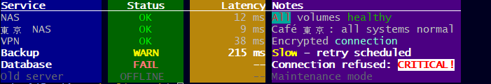

# Styled Arguments

## Structured styled text

Use `styled_text` to compose text with independently styled parts. Include
`<tjg/color/styled_text.hpp>` for the owning type and its composition operations.
Include `<tjg/color.hpp>` to use it with `std::format`,
`std::format_to`, or `std::println`. Use `{:?}` to inspect the tree.

The tree owns its text. Copies share immutable leaf strings and have their own
styles and child lists. Moves leave the source empty and unstyled.

### Concatenation preserves each part's style

Both `+` and `+=` concatenate complete styled spans. `+` returns a new value;
`+=` appends to the value on its left. Neither operation extends an existing
span's style over the text added after it, even if that span contains several
styled parts.

```cpp
auto red_text = tjg::color::underlay(tjg::color::fg(tjg::color::rgb::red),
    "red text with " + tjg::color::bold("nested bold") + " still red");
auto line = tjg::color::styled_text{"plain | "} + red_text + " | plain again";
std::println("{}", line);
```

Expected output (followed by a newline):

<pre class="color-output">plain | <span style="color: #FF0000">red text with <strong>nested bold</strong> still red</span> | plain again</pre>

Only the middle phrase is red, and only `nested bold` is also bold. The prefix
and suffix use terminal defaults. The same boundary is preserved when appending
in place:

```cpp
auto extended = red_text;
extended += " | plain again";
```

The appended text is outside the red span. A plain string has no style of its
own; it inherits a surrounding group style only when you apply one to the
combined text. Empty text adds nothing.

### Use `underlay` to supply group defaults

Concatenate the parts first, then use `underlay(style, text)` to supply defaults
for the combined text. Existing foreground and background colors are preserved.
The supplied colors fill unspecified channels in the root style. During
formatting, each relative child inherits colors it does not specify; explicit
child colors take precedence. Emphasis combines by OR.

```cpp
auto words = tjg::color::styled_text{"red", tjg::color::fg(tjg::color::rgb::red)}
    + " " + tjg::color::styled_text{"green", tjg::color::fg(tjg::color::rgb::green)}
    + " " + tjg::color::styled_text{"blue", tjg::color::fg(tjg::color::rgb::blue)};
auto defaults = tjg::color::fg(tjg::color::rgb::black).bg(tjg::color::rgb::light_gray);
auto group = tjg::color::underlay(defaults, words);
std::println("{}", group);
```

Expected output (followed by a newline):

<pre class="color-output"><span style="color: #000000; background-color: #D3D3D3"><span style="color: #FF0000">red</span> <span style="color: #008000">green</span> <span style="color: #0000FF">blue</span></span></pre>

Each word keeps its foreground color. The spaces use the black default
foreground, and the light-gray background covers the whole group.

The free function returns an owning value; named inputs are copied and rvalues
can be moved. The member updates the value in place:

```cpp
words.underlay(defaults);
```

Underlay modifies only the root style. Formatting carries those defaults to
relative descendants without changing their stored styles. An absolute scope
starts from terminal initial conditions instead of inheriting outer defaults.

### Use `overlay` for explicit overrides

`overlay(overrides, text)` replaces the specified colors throughout the text
tree, adding emphasis by OR. It skips existing absolute nodes and their entire
subtrees. Use it when the supplied colors should replace explicit choices:

```cpp
auto all_red = tjg::color::overlay(tjg::color::fg(tjg::color::rgb::red), words);
std::println("{}", all_red);
```

Expected output (followed by a newline):

<pre class="color-output"><span style="color: #FF0000; background-color: #D3D3D3">red green blue</span></pre>

Here `words` has the defaults added by the preceding member call. All relative
parts become red, and the gray background remains. `words` itself is unchanged.
The member `words.overlay(overrides)` applies the same recursive modification
in place. Unlike `underlay`, overlay changes stored styles in descendants.
Neither operation changes how formatting combines enclosing and inner styles.

To overlay only the root style, use the style getter and setter:

```cpp
words.style(words.style().overlay(tjg::color::fg(tjg::color::rgb::red)));
```

That changes the root foreground; the words' explicit foregrounds still take
precedence during formatting. Appending text with `+` or `+=` adds a separate
span. Concatenate before underlaying defaults or applying overrides if the new
text should be included.

### Absolute spans ignore the surrounding style

Use `absolute(text)` to make a span independent of its enclosing style. It
preserves the span's colors, emphasis, and children, and marks only its root
absolute. Like `overlay`, it returns an owning value: named inputs are copied
and temporaries can be moved. Narrow and wide strings are also accepted.
For a style value, `absolute(style)` returns an absolute copy of that style.

An absolute style describes the complete appearance of its span. Missing
foreground and background colors mean terminal defaults, and absent emphasis
means off. Children inside an absolute group can inherit from that group as
usual. Outer recursive overlays also skip the absolute node and its entire
subtree.
After the absolute span, the surrounding appearance resumes.

On entry to an absolute group, the formatter emits an SGR reset and applies
the group's style before visiting its children. This can emit SGR even when
the remaining precision clips all of the group's text. An absolute leaf resets
when it writes text or padding. These resets occur even when the terminal
already has the same attributes. Relative descendants inherit the group's
style, and an absolute descendant establishes its own reset boundary.

```cpp
auto underline_only = tjg::color::absolute(tjg::color::underline("underline only"));
auto sentence = tjg::color::styled_text{"before "} + underline_only + " after";
auto decorated = tjg::color::strike(
    tjg::color::underlay(tjg::color::bg(tjg::color::gray_color{12}), sentence));
std::println("{}", decorated);
```

Expected output (followed by a newline):

<pre class="color-output"><span style="background-color: #808080; text-decoration: line-through">before </span><span style="text-decoration: underline">underline only</span><span style="background-color: #808080; text-decoration: line-through"> after</span></pre>

`before ` and ` after` have a gray background and strikethrough. The absolute
span is underlined, without strikethrough or the gray background. The text after
it resumes both surrounding properties.

### Formatting and plain text

Formatting leaves the value unchanged. Relative roots inherit the enclosing
shared terminal state's colors and emphasis. After the complete replacement field,
the enclosing style is restored. The shared state initially assumes terminal
defaults. See the [shared-state rules](index.md) for single-threaded use and
nested formatting calls.

The formatter tracks the last style emitted to the terminal separately from
the enclosing group style. Relative groups emit no SGR on entry or exit.
Immediately before writing a leaf's text or padding, it emits the transition
from the recorded terminal state to the required style. Successive leaves
therefore transition directly without first restoring intermediate group
styles. At field completion, it restores the enclosing shared
style from the last emitted state.

```cpp
tjg::color::print(tjg::color::underline(), "The result is {} after rounding.",
           tjg::color::styled_text{"42", tjg::color::fg(tjg::color::term_color::bright_red)});
```

Expected output (without a trailing newline):

<pre class="color-output"><span style="text-decoration: underline">The result is <span style="color: #FF0000">42</span> after rounding.</span></pre>

The whole sentence is underlined, and `42` is also bright red. An absolute
root temporarily replaces the enclosing style, then restores it on completion.

Styled text accepts ordinary string fill, alignment (`<`, `>`, `^`), width,
and precision, with optional `s` presentation. Width and precision may also be
dynamic arguments. For tree inspection, use the separate `?` presentation
described below.

```cpp
std::println("{:*>12.9}", tjg::color::bold("hello " + tjg::color::styled_text{"world", tjg::color::fg(tjg::color::rgb::blue)}));
// Three '*' characters followed by "hello wor", all bold; "wor" is blue.
```

Expected output (followed by a newline):

<pre class="color-output"><span style="font-weight: bold">***hello <span style="color: #0000FF">wor</span></span></pre>

One precision limit applies across the whole tree. If the next character
does not fit, traversal stops. Width sets a minimum for the displayed field
after truncation. Padding uses the root style, including for empty text or
precision zero. Child styles apply to their own text. After any right padding,
the formatter restores the enclosing shared style directly from the last
emitted style.

Use `plain_text` when you need an independent string containing just the stored
text, without applying the styles:

```cpp
auto plain = line.plain_text();
// "plain | red text with nested bold still red | plain again"
```

Stored text is copied as supplied, including braces, embedded nulls, and raw
terminal escapes. Raw escapes are not interpreted or removed and can interfere
with the expected appearance. Express styling through the API when composing
styled text. Terminal support and themes can affect the displayed appearance.

For wide text, use `wstyled_text` and a wide format string. The same composition
and grouping rules apply.

### Measuring text width

The formatter estimates display width for narrow text from UTF-8 code points
using tables generated from Unicode 18.0.0. For example, `Café` occupies four
columns and `界` occupies two. Each malformed UTF-8 byte counts as one column.
Wide text uses code-unit counts. With 16-bit `wchar_t`, truncation keeps
surrogate pairs together within a leaf.

Each leaf is measured independently, so keep encoded characters within one
leaf. Generated SGR sequences take no columns. Raw escape sequences stored in
leaves are measured as text.

### Debug output

Use `{:?}` to inspect stored styles and tree structure without rendering SGR.
Each node shows its [readable style](text-style.md#readable-style-output), a
space, then either its quoted debug string or an opening `{` and newline.
An empty node style and its following space are omitted. Children are indented
two spaces per level; each closing `}` aligns with its node's style. Leaf
strings use the extension's debug escaping, including quotes, backslashes,
embedded nulls, and control characters.

```cpp
auto text = tjg::color::bold(tjg::color::styled_text{"hello\n", tjg::color::fg(tjg::color::term_color::red)}
                      + (tjg::color::underline("world") + "!"));
std::print("{:?}", text);
```

Output:

```text
b {
  red "hello\n"
  {
    _ "world"
    "!"
  }
}
```

Every child leaf and every closing brace ends with a newline. A top-level leaf
has no trailing newline: an empty unstyled leaf displays `""`, and a bold leaf
displays `b "hello"`. No additional outer enclosure is added. Debug output
shows stored node styles, without resolving inheritance or modifying the tree.
Wide trees support the same presentation. Use `{:?}` for the complete tree.
Combining `?` with a width or precision is a format error, including with
dynamic arguments.

### Stream insertion

Include `<tjg/color.hpp>` to insert a `styled_text` tree into a narrow
stream or a `wstyled_text` tree into a wide stream. Insertion uses the same ANSI
rendering as the styled-text formatter.

```cpp
#include <tjg/color.hpp>
#include <iomanip>
#include <sstream>

std::ostringstream os;
os << std::left << std::setfill('*') << std::setw(14)
   << tjg::color::bold("hello world");
// Bold "hello world***", followed by a reset to terminal defaults.
```

Stream width, fill, and alignment control padding. Left alignment pads after
the text. Right, internal, and default alignment pad before it. Padding uses
the effective root style, and generated SGR takes no columns. A negative or
zero width adds no padding. Stream precision has no effect on the tree. Use
the styled-text formatter with an explicit precision to truncate it.

Insertion consumes the field width and resets it to zero. It preserves fill,
precision, and flags. A stream already in an error state keeps its pending
width. A short write sets `badbit`, and the stream's exception mask controls
whether the failure throws. For a debug tree dump, insert the result of
`std::format("{:?}", text)` or its wide equivalent.

### Table demonstration

The complete [TableDemo.cpp](https://github.com/tjgolubi/fmt/blob/color-dev/demo/TableDemo.cpp)
example combines column backgrounds, independently colored cell contents, row
emphasis, and an absolute warning span. It also demonstrates UTF-8 display
widths and fixed-width padding and truncation.

From the repository root, build and run the table demo with:

```sh
make -C demo TableDemo
./demo/TableDemo
```

The demo Makefile uses C++23, header-only formatting, and compact SGR output.
Run `make -C demo` to build both `FmtColorDemo2` and `TableDemo`,
`make -C demo run` to run both, and `make -C demo clean` to remove both
executables. The extension requires C++23.

#### Apply column defaults beneath cell styles

Each column supplies a foreground and background. The cell helper uses
`underlay` so explicit colors in a cell take precedence:

```cpp
constexpr auto notes_color =
    tjg::color::fg(tjg::color::term_color::white).bg(tjg::color::rgb::indigo);

auto cell(tjg::color::styled_text text, tjg::color::text_style column) -> tjg::color::styled_text {
  return tjg::color::underlay(column, text);
}

auto nas_note = tjg::color::styled_text{"All",
                   tjg::color::fg(tjg::color::term_color::red).bg(tjg::color::term_color::cyan)}
    + " volumes "
    + tjg::color::styled_text{"healthy", tjg::color::fg(tjg::color::term_color::green)};
```

With `cell(nas_note, notes_color)`, `All` keeps its red foreground and cyan
background. The plain ` volumes ` inherits the column's white foreground and
indigo background; `healthy` keeps its green foreground and inherits indigo.
Padding also uses the column defaults. Using `overlay` here would replace
explicit colors throughout the relative cell contents.

#### Combine row emphasis with fixed-width fields

The demo's `print_row` function passes the row style to `println` and formats
four cells:

```cpp
tjg::color::println(row, "{:<16.16} {:^12.12} {:>12.12} {:<30.30}",
             cell(std::move(service), service_color),
             cell(std::move(status), status_color),
             cell(std::move(latency), latency_color),
             cell(std::move(notes), notes_color));
```

Service and Notes are left-aligned, Status is centered, and Latency is
right-aligned. Each field uses equal width and precision: short text is padded
and long text is truncated to the column width. The literal spaces between
fields use the row style rather than a column background.

The heading row supplies `tjg::color::bold().underline()`, the Backup row supplies
`tjg::color::bold()`, and the Old server row supplies `tjg::color::faint()`. Relative cell
contents inherit that emphasis while retaining their explicit colors and
column backgrounds.

#### Protect an absolute span

The Database row contains an absolute red-on-white warning:

```cpp
constexpr auto critical_style = tjg::color::fg(tjg::color::rgb::red)
    .bg(tjg::color::rgb::white).bold().blink().absolute();
auto db_note = tjg::color::styled_text{"Connection refused: "}
    + tjg::color::styled_text{"CRITICAL!", critical_style}
    + " Database service is unavailable";
```

`CRITICAL!` uses its own foreground, background, and emphasis. The column style
resumes after it. The Notes field's precision of 30 cuts off the trailing
explanation.



`東京` occupies six UTF-8 bytes and `Café` occupies five. Both have an estimated
display width of four columns. An ANSI-capable terminal shows the native
styling, including blink where supported.

## Parsing SGR text

Include `<tjg/color.hpp>` and call `parse_styled_text` to turn text containing
ordinary ANSI SGR into an owned `styled_text` (or `wstyled_text` for wide input).

```cpp
auto message = tjg::color::parse_styled_text("plain \x1b[31mred\x1b[0m plain");
std::println("{}", message);
```

The parser follows the SGR state changes; it does not add an initial reset.
Before the first reset, parsed spans are relative and can inherit an enclosing
formatting style. A reset establishes terminal defaults for **all following
text**, not just the next span.

If a reset occurs before any text, the returned root is absolute. Otherwise,
earlier text remains relative and the suffix beginning at the reset forms an
absolute group. Its children have relative styles based on terminal defaults.
Later resets clear the current style within that same group; they do not create
additional nested groups. A single run can be represented directly by a leaf.

For example, a reset prevents an enclosing underline from returning on later
text, even when that text enables another attribute:

```cpp
auto parsed = tjg::color::parse_styled_text("\x1b[1mA\x1b[mB\x1b[1mC");
tjg::color::println(tjg::color::underline(), "{}", parsed);
```

Expected output (followed by a newline):

<pre class="color-output"><span style="font-weight: bold; text-decoration: underline">A</span>B<span style="font-weight: bold">C</span></pre>

`A` inherits underline and adds bold. The reset before `B` establishes defaults,
so `B` is plain and `C` adds only bold. Formatting still restores the enclosing
style after the complete parsed value.

As with other relative styles, an unset attribute before the first reset does
not cancel an inherited attribute; selective clearing of an unknown enclosing
state cannot be represented by these relative style values. Use an explicit
reset when the input must establish a complete state independent of its context.

Consecutive SGR sequences update one current style. No empty leaves are emitted;
adjacent text with equal styles is combined within each group. A trailing SGR
without text creates no span or empty group. The result represents styled text,
not the original escape bytes or a trailing command's effect on terminal state.
Input text is copied, including embedded nulls when supplied through a sized
string or string view.

Recognized codes cover the library's eight emphasis attributes and their
removal, normal/bright terminal colors, indexed colors, truecolor, and
default-color restoration. Reset (`0`, empty parameters, or leading-zero forms)
clears the current style. Indexed and RGB colors accept semicolon forms and
colon forms, including an omitted/default RGB color space field. Unicode code
units are preserved without decoding.

Non-SGR escapes, including uppercase `M` commands and opaque OSC/DCS payloads,
remain verbatim text. Malformed SGR (including incomplete/out-of-range supported
colors or numeric overflow) is preserved in full and does not change style.
Unknown valid parameters and unsupported colon subparameter groups are ignored.
For an unknown semicolon extended-color mode, the remainder of that SGR is
ignored because its payload boundary is unknown. Preserved raw terminal commands
can affect the terminal outside the style model; parsing is not sanitization.

## Stripping ANSI sequences

Include `<tjg/strip_ansi.hpp>` and call `strip_ansi` to obtain an owning string
with complete ESC-prefixed ANSI sequences removed:

```cpp
auto plain = tjg::strip_ansi("\x1b[31mred\x1b[0m"); // "red"
```

The character-generic function accepts `std::basic_string_view<Char>`; convenience
overloads accept narrow/wide literals and standard strings. It recognizes CSI,
OSC, DCS, SOS, PM, APC, and ordinary ESC sequences by syntax. Private and
unknown commands are removed too, without validating parameter meanings. OSC
ends at BEL or `ESC \`; the other control strings end at `ESC \`. Their payloads
and terminators are removed with them. Hyperlink labels outside OSC markers
remain.

Standalone C0 controls (such as tabs, newlines, and embedded nulls) and
single-byte C1 forms are preserved. Malformed or incomplete escape prefixes are
preserved; scanning resumes at an interrupting character so a subsequent
independent escape can still be removed. Unterminated control strings are
preserved in full, including any apparent escapes inside their payload. CAN and
SUB cancel a control string: its preceding bytes and the cancellation character
are retained, and scanning resumes at that character. Text code units are copied
without Unicode decoding.

This function does not simulate cursor movement, erase commands, carriage
returns, or other terminal behavior, and is not a security sanitizer. Unlike
`parse_styled_text(...).plain_text()`, it removes non-SGR escapes too, without
constructing a styled tree.

Include `<tjg/color.hpp>` for the styled-text overload. It
returns a new `basic_styled_text<Char>` with the same
tree structure, styles, and absolute boundaries. It strips ANSI sequences from
each leaf independently, retaining leaves that become empty and sharing
unchanged leaf strings. The input is unchanged. Sequences split across leaves
are preserved.

```cpp
auto text = tjg::color::bold("\x1b[31mred\x1b[0m");
auto clean = tjg::color::strip_ansi(text); // Bold "red", with raw escapes removed.
auto plain = clean.plain_text();   // "red", without the tree's styling.
```

Both narrow and wide styled text are supported. To strip sequences after joining
all leaves, call `strip_ansi(text.plain_text())` instead; this also removes any
complete sequences formed across leaf boundaries.

## Backslash escaping and unescaping

Include `<tjg/backslash.hpp>` for `backslash_escape` and `backslash_unescape`.
These independent text utilities return owning strings and support narrow and
wide text, including embedded NULs when passed a string or a length-bearing view.
They require neither ANSI parsing nor styled text.

```cpp
#include <tjg/backslash.hpp>

auto readable = tjg::backslash_escape("\x1b[31mred\x1b[0m\n");
// readable contains the literal text: \e[31mred\e[0m\n
auto original = tjg::backslash_unescape(readable);
```

The decoder accepts the following escape sequences. The last column describes
the canonical spelling produced by `backslash_escape` and `backslash_escape_to`.

| Escape | Character or value   | ASCII  | Emits |
| ------ | -------------------- | ------ | ----- |
| `\a`   | Alert (bell)         | `0x07` | Yes   |
| `\b`   | Backspace            | `0x08` | Yes   |
| `\e`   | Escape (ESC)         | `0x1b` | Yes   |
| `\f`   | Form feed            | `0x0c` | Yes   |
| `\n`   | Line feed (newline)  | `0x0a` | Yes   |
| `\r`   | Carriage return      | `0x0d` | Yes   |
| `\t`   | Horizontal tab       | `0x09` | Yes   |
| `\v`   | Vertical tab         | `0x0b` | Yes   |
| `\\`   | Backslash            | `0x5c` | Yes   |
| `\"`   | Double quote         | `0x22` | Yes   |
| `\'`   | Apostrophe           | `0x27` | No    |
| `\?`   | Question mark        | `0x3f` | No    |
| `\x00` | NUL                  | `0x00` | Yes   |
| `\x7f` | Delete (DEL)         | `0x7f` | Yes   |
| `\xhh` | Exactly 2 hex digits | `0xhh` | Yes   |
| `\nnn` | 1 to 3 octal digits  |        | No    |
| `\u`   | Exactly 4 hex digits |        | No    |
| `\U`   | Exactly 8 hex digits |        | No    |

`backslash_escape` uses `\a`, `\b`, `\e`, `\f`, `\n`, `\r`, `\t`, and `\v` for
the corresponding controls. `\e` represents ESC (`0x1b`); it is an extension to
the standard C++ escape spellings. It uses `\xhh` with two lowercase hexadecimal
digits for other ASCII C0 controls and DEL (`0x7f`), including `\x00` for NUL.
Literal backslashes become `\\` and double quotes become `\"`. Other code units,
including non-ASCII text and UTF-8 bytes, are preserved. No surrounding quotes
are added.

`backslash_unescape` recognizes those forms, plus `\'` for an apostrophe and
`\?` for a question mark. Ordinary apostrophes and question marks remain
unchanged when escaping. Hex digits may use either case. The decoder also
accepts one to three octal digits (`\0` through `\377`). A `\x` escape consumes
exactly two hex digits, and an octal escape consumes at most three digits.
Subsequent digits remain ordinary text.

Unicode escapes take exactly four hex digits after `\u` and eight after `\U`.
For example, `backslash_unescape("\\u754C\\U0001F600")` produces the UTF-8 string
`界😀`. Wide output uses UTF-16 with 16-bit `wchar_t` and UTF-32 with 32-bit
`wchar_t`. Use `\U` for a code point above `U+FFFF`.

Unknown or malformed escapes throw `std::invalid_argument`. Examples include
`\q`, `\xG1`, `\u123`, a trailing backslash, and braced numeric escapes.
Unicode escapes naming surrogates also throw `std::invalid_argument`.
Octal values above 255 and Unicode values above `U+10FFFF` throw
`std::out_of_range`. The decoder preserves
surrounding quotes and processes each escape once. If `backslash_unescape_to`
throws, output already written remains in the destination.

To write into an existing destination, use `backslash_escape_to(out, text)` or
`backslash_unescape_to(out, text)`. Both accept output iterators and return the
advanced iterator. They support narrow and wide string views, literals, and
strings without allocating an intermediate string.

```cpp
#include <iterator>
#include <string>

std::string log = "Received: ";
tjg::backslash_escape_to(std::back_inserter(log), "\x1b[31mred\n");
// log contains: Received: \e[31mred\n
```

The iterator and owning-string functions support constant evaluation when the
standard library and output iterator support it. Any dynamic storage allocated
during constant evaluation must be released within that
constant evaluation; these functions can produce temporary strings for a
compile-time check.

The output must not invalidate or overwrite unread input. In particular, do not
append to the string supplying the input view, since reallocation can invalidate
that view.

`backslash_unescape(backslash_escape(text))` recovers the original code units.
To inspect a styled value's text, pass `text.plain_text()`; to inspect its
emitted SGR sequences too, pass the formatted string. These functions do not
interpret ANSI sequences or remove explicit styles.

## Individual styled arguments

Include `<tjg/color.hpp>` to style an individual replacement
field with `styled`. Its format specifications apply to the underlying value.

::: styled(const T&, text_style)
    options:
      color_reference: true

Expected output for the example above (without a trailing newline):

<pre class="color-output">Elapsed time: <span style="color: #008000; background-color: #191970">1.23</span> seconds</pre>

```cpp
std::println("Amount: {:>8.2f}",
             tjg::color::styled(1.23, tjg::color::fg(tjg::color::rgb::green)));
```

Expected output (followed by a newline):

<pre class="color-output">Amount: <span style="color: #008000">    1.23</span></pre>

The width and precision apply to the number, including padding inside the styled
span. Relative styles inherit the shared terminal state; absolute styles replace
it for this value and always emit an explicit reset, even
when the enclosing state already has the same attributes. Both restore the
enclosing style afterward. For examples, see
[Text style rendering](index.md#TextStyleRendering).

To insert a styled value directly into an ostream, include
`<tjg/color.hpp>` and use `os << tjg::color::styled(value, style)`.
[Styled stream insertion](print.md#styled-stream-insertion) describes stream
formatting, wide streams, and the wrapper's reference lifetime.

```cpp
#include <tjg/color.hpp>
#include <iomanip>
#include <iostream>
#include <numbers>

auto style = tjg::color::fg(tjg::color::rgb::green).bold();
std::cout << "Pi: " << std::fixed << std::setprecision(2)
          << tjg::color::styled(std::numbers::pi, style) << '\n';
```

Expected output (followed by a newline):

<pre class="color-output">Pi: <span style="color: #008000; font-weight: bold">3.14</span></pre>

Only `3.14` is styled in bold green. The value is rounded to two decimal places
using the ostream's formatting settings.

